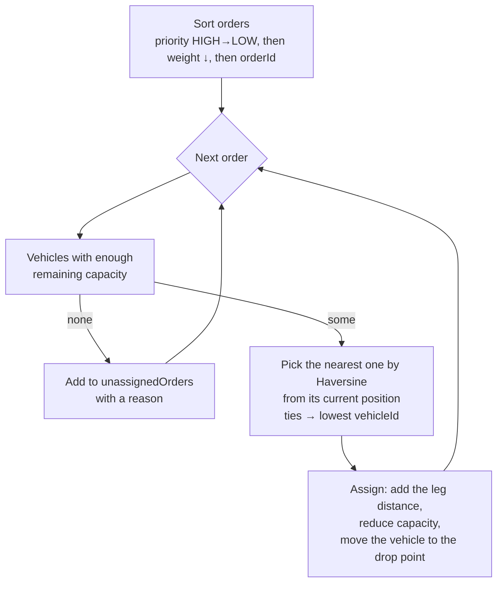
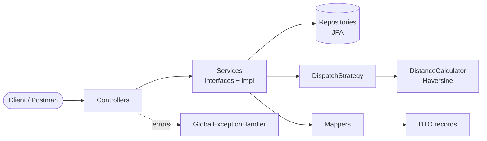

<div align="center">

# 🚚 Dispatch Load Balancer

**A Spring Boot REST service that assigns delivery orders to a vehicle fleet:<br>
capacity-safe, priority-first and distance-aware (Haversine).**


[**Live demo**](#-live-demo) ·
[**API**](#-api-reference) ·
[**Algorithm**](#-dispatch-algorithm) ·
[**Run locally**](#-running-locally) ·
[**Tests**](#-tests-and-coverage)

</div>

---

## ✨ Highlights

| | |
|---|---|
| 🧭 **Smart dispatch** | Greedy nearest-vehicle strategy: HIGH → MEDIUM → LOW, heaviest first, never over capacity |
| 🔌 **Swappable algorithm** | `DispatchStrategy` and `DistanceCalculator` are interfaces (Strategy pattern) |
| ⚡ **Efficient DB access** | Bulk upsert: 1 lookup query plus JDBC batches. 250 orders take ≤ 4 statements |
| 🛡️ **Robust errors** | Bean Validation and one consistent JSON error body for every 4xx/5xx |
| ✅ **Tested** | 114 tests (unit, MockMvc and integration) with 100% line coverage, enforced by JaCoCo |
| ☁️ **Deployed** | Docker and a Render Blueprint with managed PostgreSQL |

---

## 🌐 Live demo

The service runs on Render with the 30 sample orders and 5 vehicles from the assignment already loaded.

| | URL |
|---|---|
| 📘 Swagger UI | https://dispatch-load-balancer-uiw3.onrender.com/swagger-ui.html |
| 📦 Dispatch plan | https://dispatch-load-balancer-uiw3.onrender.com/api/dispatch/plan |
| 💚 Health | https://dispatch-load-balancer-uiw3.onrender.com/actuator/health |

> [!NOTE]
> The app runs on Render's free tier and sleeps after about 15 minutes of inactivity.
> The first request after that can take up to a minute while it wakes up.

---

## 🛠️ Tech stack

| Layer | Technology |
|---|---|
| Language | Java 17 |
| Framework | Spring Boot 3.5 (Web, Data JPA, Validation, Actuator) |
| Database | H2 in-memory (default) · PostgreSQL (`postgres` profile) |
| API docs | springdoc-openapi 2.8 (Swagger UI) |
| Testing | JUnit 5 · Mockito · AssertJ · MockMvc · JaCoCo |
| Build and deploy | Maven (wrapper included) · Docker · Render |

---

## 📡 API reference

Base path: **`/api/dispatch`**. All request and response bodies are JSON.

| Method | Endpoint | Description | Success |
|:---:|---|---|:---:|
| `POST` | `/api/dispatch/orders` | Submit delivery orders (upsert by `orderId`) | `200` |
| `POST` | `/api/dispatch/vehicles` | Submit fleet details (upsert by `vehicleId`) | `200` |
| `GET` | `/api/dispatch/plan` | Compute the dispatch plan | `200` |
| `DELETE` | `/api/dispatch/orders` | Delete all orders | `204` |
| `DELETE` | `/api/dispatch/vehicles` | Delete all vehicles | `204` |

### 1️⃣ Submit delivery orders

```http
POST /api/dispatch/orders
Content-Type: application/json
```

```json
{
  "orders": [
    {
      "orderId": "ORD001",
      "latitude": 12.9716,
      "longitude": 77.5946,
      "address": "MG Road, Bangalore, Karnataka, India",
      "packageWeight": 10,
      "priority": "HIGH"
    }
  ]
}
```

**Response `200 OK`**

```json
{ "message": "Delivery orders accepted.", "status": "success" }
```

<details>
<summary><b>Field rules</b></summary>

| Field | Type | Rules |
|---|---|---|
| `orderId` | string | required, non-blank, ≤ 64 chars, unique within the request |
| `latitude` | number | required, −90 to 90 |
| `longitude` | number | required, −180 to 180 |
| `address` | string | required, non-blank, ≤ 255 chars |
| `packageWeight` | number | required, > 0 |
| `priority` | enum | required: `HIGH`, `MEDIUM` or `LOW` (case-insensitive) |

Re-posting an existing `orderId` **updates** that order. It never creates a duplicate.

</details>

### 2️⃣ Submit fleet details

```http
POST /api/dispatch/vehicles
Content-Type: application/json
```

```json
{
  "vehicles": [
    {
      "vehicleId": "VEH001",
      "capacity": 100,
      "currentLatitude": 12.9716,
      "currentLongitude": 77.6413,
      "currentAddress": "Indiranagar, Bangalore, Karnataka, India"
    }
  ]
}
```

**Response `200 OK`**

```json
{ "message": "Vehicle details accepted.", "status": "success" }
```

<details>
<summary><b>Field rules</b></summary>

| Field | Type | Rules |
|---|---|---|
| `vehicleId` | string | required, non-blank, ≤ 64 chars, unique within the request |
| `capacity` | number | required, > 0 |
| `currentLatitude` | number | required, −90 to 90 |
| `currentLongitude` | number | required, −180 to 180 |
| `currentAddress` | string | required, non-blank, ≤ 255 chars |

</details>

### 3️⃣ Get the dispatch plan

```http
GET /api/dispatch/plan
```

**Response `200 OK`** (first vehicle and first unassigned order shown):

```json
{
  "dispatchPlan": [
    {
      "vehicleId": "VEH002",
      "totalLoad": 80,
      "totalDistance": "0.00 km",
      "assignedOrders": [
        {
          "orderId": "ORD020",
          "latitude": 28.5355,
          "longitude": 77.391,
          "address": "Sector 18, Noida, Uttar Pradesh, India",
          "packageWeight": 30,
          "priority": "HIGH"
        }
      ]
    }
  ],
  "unassignedOrders": [
    {
      "orderId": "ORD016",
      "reason": "No vehicle has enough remaining capacity for package weight 30"
    }
  ],
  "message": "8 order(s) could not be assigned. See unassignedOrders for details."
}
```

| Field | Description |
|---|---|
| `dispatchPlan[]` | One entry per vehicle, sorted by `vehicleId`. Idle vehicles are included with `totalLoad: 0` and `"0.00 km"`. |
| `totalLoad` | Sum of the assigned package weights |
| `totalDistance` | Route length start → stop 1 → … → stop n, formatted as `"X.XX km"` |
| `assignedOrders[]` | Full order objects, including `address`, in delivery order |
| `unassignedOrders[]` | ➕ Extra field: orders that could not be placed, each with a `reason` |
| `message` | ➕ Extra field: present only for edge cases |

Apart from the two ➕ extra fields, the response matches the shape in the specification.

<details>
<summary><b>Edge cases</b>: <code>GET /plan</code> always returns <code>200</code></summary>

An empty plan is a valid answer, not an error, so the `message` field explains the situation.

| Situation | `dispatchPlan` | `unassignedOrders` | `message` |
|---|---|---|---|
| No orders and no vehicles | `[]` | `[]` | No orders or vehicles available… |
| No orders | idle vehicles | `[]` | No orders available to dispatch. |
| No vehicles | `[]` | all orders: *No vehicles available* | No vehicles available. All orders are unassigned. |
| Order heavier than every vehicle | … | *Package weight 500 exceeds the capacity of every vehicle (largest capacity: 120)* | N order(s) could not be assigned… |

</details>

### 4️⃣ Reset data

```bash
curl -X DELETE http://localhost:8080/api/dispatch/orders     # 204 No Content
curl -X DELETE http://localhost:8080/api/dispatch/vehicles   # 204 No Content
```

### 📮 Postman

Import [`postman/DispatchLoadBalancer.postman_collection.json`](postman/DispatchLoadBalancer.postman_collection.json)
and set the `baseUrl` variable (default `http://localhost:8080`, or the live URL). It contains three folders,
each with test assertions:

1. **Sample data flow**: reset, then the 30 orders and 5 vehicles from the PDF, then the plan
2. **Specification example**: the Bangalore/Chennai example from the API spec
3. **Error handling**: validation, invalid priority, malformed JSON, duplicates, an overweight order

---

## ⚠️ Error format

Every error returns the same body:

```json
{
  "status": "error",
  "message": "Validation failed",
  "errors": [
    { "field": "orders[0].latitude", "message": "latitude must be between -90 and 90" },
    { "field": "orders[0].packageWeight", "message": "packageWeight must be greater than 0" }
  ],
  "timestamp": "2026-10-19T10:55:22.699Z"
}
```

| Situation | Status | `message` |
|---|:---:|---|
| Validation failure (range, required, > 0, empty list) | `400` | `Validation failed`, with one entry per field |
| Invalid enum, e.g. `"priority": "URGENT"` | `400` | `Invalid value in request body`: *Allowed values: [HIGH, MEDIUM, LOW]* |
| Wrong type, e.g. `"latitude": "north"` | `400` | `Invalid value in request body` |
| Malformed or missing JSON | `400` | `Malformed JSON request` |
| Same ID twice in one request | `400` | `Duplicate IDs in request` (nothing is saved) |
| Unknown path | `404` | `Resource not found: /…` |
| Wrong HTTP method | `405` | `HTTP method GET is not supported for this endpoint` |
| Non-JSON `Content-Type` | `415` | `Content-Type must be application/json` |
| Unexpected server error | `500` | `An unexpected error occurred…` (details are logged, never returned) |

---

## 🧠 Dispatch algorithm

Implemented in `GreedyNearestVehicleStrategy`, behind the `DispatchStrategy` interface.



| Requirement | How it is met |
|---|---|
| Load ≤ capacity | A vehicle is a candidate only if its **remaining** capacity fits the order (with a 1e-9 tolerance for floating-point error) |
| High priority first | Orders are processed strictly by priority, so a LOW order never takes space a HIGH order needs |
| Minimise distance | Each order goes to the vehicle whose **current** position (its last drop, or its depot) is nearest, so routes stay compact |
| Better packing | Heaviest-first within a priority (first-fit decreasing) |
| Haversine | `HaversineDistanceCalculator` with an Earth radius of 6371 km |

**Performance.** O(n log n + n·m) time and O(n + m) memory for *n* orders and *m* vehicles. A plan takes exactly
**two database queries**. The rest runs in memory, with no database access inside loops.

**Trade-offs.** Capacitated vehicle routing is NP-hard. This greedy heuristic is fast, deterministic and
explainable, but **not globally optimal**:

- Each choice is local, so the nearest vehicle now may not be the best choice for the whole fleet.
- Stops are visited in assignment order. There is no 2-opt or TSP reordering.
- Priority is strict. One heavy HIGH order beats several light LOW orders.
- Distances are straight-line (great-circle), not road distances.

Because the algorithm is a **Strategy**, a better optimiser (Clarke–Wright savings, OR-Tools) or a road-distance
`DistanceCalculator` can replace it without touching the controllers or services.

### Result on the assignment's sample data

645 units of orders and 500 units of fleet capacity. **All 12 HIGH orders are assigned.** 8 LOW orders don't fit.

| Vehicle | Capacity | Load | Distance | Orders (stop order) |
|:---:|:---:|:---:|:---:|---|
| VEH001 | 100 | 100 | 14.44 km | ORD026 · ORD007 · ORD011 · ORD015 · ORD001 |
| VEH002 | 80 | 80 | 0.00 km | ORD020 · ORD023 · ORD027 |
| VEH003 | 120 | 115 | 24.74 km | ORD013 · ORD005 · ORD009 · ORD017 · ORD010 |
| VEH004 | 90 | 90 | 19.80 km | ORD029 · ORD004 · ORD008 · ORD012 |
| VEH005 | 110 | 105 | 14.44 km | ORD018 · ORD021 · ORD025 · ORD002 · ORD006 |

**Unassigned (all LOW):** ORD003 · ORD014 · ORD016 · ORD019 · ORD022 · ORD024 · ORD028 · ORD030

---

## 🏗️ Architecture



<details>
<summary><b>Package structure</b></summary>

```text
com.dispatch
├── controller   REST endpoints only (thin, no business logic)
├── dto          Java records for requests and responses, with Bean Validation
├── entity       JPA entities Order and Vehicle, plus the Priority enum
├── repository   Spring Data JPA repositories
├── service      Service interfaces
│   └── impl     Implementations plus UpsertSupport (shared bulk-upsert logic)
├── strategy     DispatchStrategy, GreedyNearestVehicleStrategy and result types
├── util         DistanceCalculator, HaversineDistanceCalculator
├── mapper       Entity ↔ DTO conversion
├── exception    DuplicateIdException, GlobalExceptionHandler
└── config       OpenAPI metadata, Jackson module (writes 10 rather than 10.0)
```

</details>

| Design pattern | Where |
|---|---|
| **Strategy** | `DispatchStrategy` (algorithm) and `DistanceCalculator` (metric) are injected interfaces |
| **Layered architecture** | Controller → Service → Repository, each with one responsibility |
| **Dependency inversion** | Constructor injection, and every layer depends on interfaces |
| **DTO + Mapper** | The API contract (records) is decoupled from the persistence model (entities) |
| **Global exception handling** | `@RestControllerAdvice` produces one error format |
| **Template method / shared helper** | `UpsertSupport.prepareUpsert` contains the generic upsert workflow |

**Database efficiency**

- **Upsert without N+1 queries.** Entities implement `Persistable`. Existing rows are loaded with one chunked `findAllById`, then a single `saveAll` writes everything.
- **JDBC batching.** `batch_size=100` with `order_inserts` and `order_updates`. On Postgres, `reWriteBatchedInserts` is enabled.
- **Bulk delete.** `deleteAllInBatch()` issues a single `DELETE`.
- **Read-only transaction** for the plan, and `open-in-view` is disabled.

---

## 💻 Running locally

**Prerequisite:** JDK 17 or newer. Maven isn't required because the wrapper downloads it.

```bash
./mvnw spring-boot:run          # Windows: mvnw.cmd spring-boot:run
```

The app starts at **http://localhost:8080** with an in-memory H2 database.

| URL | Purpose |
|---|---|
| http://localhost:8080/swagger-ui.html | Swagger UI |
| http://localhost:8080/v3/api-docs | OpenAPI spec |
| http://localhost:8080/actuator/health | Health check |
| http://localhost:8080/h2-console | H2 console (`jdbc:h2:mem:dispatchdb`, user `sa`) |

**Try it with the sample data:**

```bash
curl -X POST localhost:8080/api/dispatch/orders \
  -H "Content-Type: application/json" -d @src/test/resources/samples/orders-request.json

curl -X POST localhost:8080/api/dispatch/vehicles \
  -H "Content-Type: application/json" -d @src/test/resources/samples/vehicles-request.json

curl localhost:8080/api/dispatch/plan
```

<details>
<summary><b>Run with PostgreSQL</b></summary>

```bash
docker run -d --name dispatch-pg -p 5432:5432 \
  -e POSTGRES_DB=dispatch -e POSTGRES_USER=postgres -e POSTGRES_PASSWORD=postgres postgres:16

./mvnw spring-boot:run -Dspring-boot.run.profiles=postgres
```

| Variable | Default |
|---|---|
| `DB_URL` | built from `DB_HOST`, `DB_PORT` and `DB_NAME` |
| `DB_HOST` / `DB_PORT` / `DB_NAME` | `localhost` / `5432` / `dispatch` |
| `DB_USERNAME` / `DB_PASSWORD` | `postgres` / `postgres` |

Tables are created automatically on first start.

</details>

<details>
<summary><b>Run with Docker</b></summary>

```bash
docker build -t dispatch-load-balancer .
docker run -p 8080:8080 dispatch-load-balancer
```

</details>

---

## ☁️ Deploying to Render

The repository is ready to deploy:

| File | Purpose |
|---|---|
| [`Dockerfile`](Dockerfile) | Multi-stage build: Maven builds the jar, then a slim JRE 17 image runs it as a non-root user |
| [`render.yaml`](render.yaml) | Render Blueprint: a Docker web service plus a PostgreSQL database, wired together |

1. In the Render dashboard choose **New → Blueprint**, then select this repository.
2. Click **Deploy Blueprint**. Render creates `dispatch-db` and `dispatch-load-balancer`.
3. When the service shows **Live**, open `https://<your-service>.onrender.com/swagger-ui.html`.

No manual environment variables are needed. The app binds to Render's `$PORT`, reads the database credentials
injected by the Blueprint and uses `/actuator/health` as its health check.

---

## ✅ Tests and coverage

```bash
./mvnw clean verify
```

This runs all tests and **fails the build if line coverage drops below 85%**. The coverage report is written to
`target/site/jacoco/index.html`.

**Result:** 114 tests · 0 failures · **100% line** · **93.9% branch** coverage

| Test class | Type | Covers |
|---|---|---|
| `HaversineDistanceCalculatorTest` | Unit | Zero distance, known city pairs, poles, antimeridian, antipodes |
| `GreedyNearestVehicleStrategyTest` | Unit | Priority order, capacity limits, exact fit, nearest vehicle, ties, route legs, edge cases |
| `SampleDataDispatchTest` | Unit | The 30 orders and 5 vehicles from the PDF: capacity, priorities, totals |
| `*ServiceImplTest` | Mockito | Upsert, duplicate detection, chunked lookup, bulk delete, plan messages |
| `*ControllerTest` | MockMvc | Every endpoint: success, validation, malformed JSON, invalid enum, 404/405/415/500 |
| `DispatchFlowIntegrationTest` | Spring Boot | POST orders → POST vehicles → GET plan, upsert, health, OpenAPI |
| `UpsertBatchingIntegrationTest` | Spring Boot | Hibernate statistics prove batching (≤ 4 statements for 250 rows) |

The live deployment also passed an end-to-end check of 31 assertions: correct plan, capacity, distances, upsert
and every error case.

---

## 📝 Assumptions

- Weights and capacities share one unit (e.g. kg). Distances are in kilometres.
- `POST` is an idempotent **upsert** and returns `200 OK`, because a batch is accepted and no single new resource is created.
- Duplicate IDs within one request are rejected with `400` rather than letting the last one silently win.
- The plan is **computed on demand**, never stored, so it always reflects the current data and is deterministic.
- A vehicle starts at its current location and visits stops in assignment order, with no return-to-depot leg.
- Priority input is case-insensitive. Unknown JSON fields are ignored. No authentication is required.

---

<div align="center">

Made by **[Mayur Patil](https://github.com/mayurvij22)**

</div>
